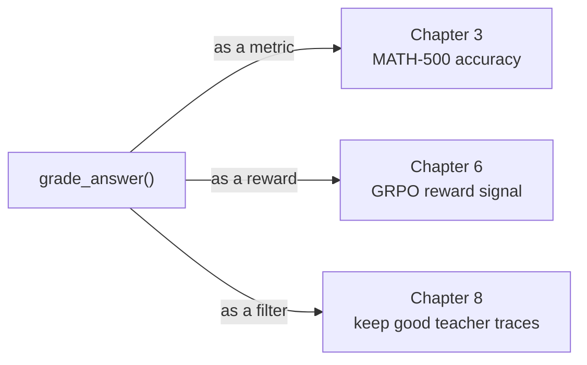

# Chapter 3 · Evaluation and the verifier

!!! abstract "In one line"

    Write the function that decides whether a free-form answer is right — then use
    it as a metric, as an RL reward, and as a data filter.

## Learning objectives

- Explain why exact-match evaluation fails on maths and what replaces it.
- Implement the four-stage verifier: extract, normalise, parse, compare.
- Reproduce the 15.6% base-model baseline on MATH-500.
- Recognise the verifier's false negatives, and why they cap your measured accuracy.

## Why this chapter is the foundation

The verifier is used three times, in three roles:



Get it wrong and every downstream number is wrong in the same direction. A
verifier that is too strict under-reports accuracy and starves RL of reward. One
that is too loose rewards nonsense and you distil wrong answers.

## The dataset

MATH-500 is the standard evaluation slice of the MATH benchmark: 500
competition-style problems with worked solutions. The file is committed in the
repo at `ch03/01_main-chapter-code/math500_test.json`, and the loader downloads
it if you do not have it.

```python title="one real item from math500_test.json"
{
  "problem": "Convert the point $(0,3)$ in rectangular coordinates to polar "
             "coordinates. Enter your answer in the form $(r,\\theta),$ where "
             "$r > 0$ and $0 \\le \\theta < 2 \\pi.$",
  "solution": "We have that $r = \\sqrt{0^2 + 3^2} = 3.$ ... "
              "Therefore, the polar coordinates are "
              "$\\boxed{\\left( 3, \\frac{\\pi}{2} \\right)}.$",
  "answer": "\\left( 3, \\frac{\\pi}{2} \\right)",
  "subject": "Precalculus",
  "level": 2,
  "unique_id": "test/precalculus/807.json"
}
```

| Field | Type | Use |
| --- | --- | --- |
| `problem` | str | Prompt |
| `solution` | str | Full worked solution — for you, not the model |
| `answer` | str | Ground truth, LaTeX |
| `subject` | str | Per-subject breakdown |
| `level` | int 1-5 | Difficulty; useful for error analysis |
| `unique_id` | str | Stable identifier |

The training set is the same schema plus a `type` field: MATH minus MATH-500,
**12,000 problems**, so there is no train/test contamination.

## Why not exact match

Because `0.5`, `1/2`, `\\frac{1}{2}` and `50\\%` are the same answer, and a
model will produce all four. Exact string match would score most of those wrong.
The verifier therefore compares *mathematical meaning*:

```text
model output  ──▶ extract last \boxed{...}  ──▶ normalise LaTeX
                                                     │
ground truth  ───────────────────────────────────────┤
                                                     ▼
                                    SymPy: simplify(gt - pred) == 0
```

## Stage 1 — extract

The convention the whole course uses is that the final answer goes in
`\\boxed{...}`. Extraction takes the **last** one, and handles nested braces:

```python title="reasoning_from_scratch/ch03.py"
def get_last_boxed(text):
    boxed_start_idx = text.rfind(r"\boxed")
    if boxed_start_idx == -1:
        return None
    current_idx = boxed_start_idx + len(r"\boxed")
    while current_idx < len(text) and text[current_idx].isspace():
        current_idx += 1
    if current_idx >= len(text) or text[current_idx] != "{":
        return None
    current_idx += 1
    brace_depth = 1
    content_start_idx = current_idx
    while current_idx < len(text) and brace_depth > 0:
        char = text[current_idx]
        if char == "{":
            brace_depth += 1
        elif char == "}":
            brace_depth -= 1
        current_idx += 1
    if brace_depth != 0:      # unbalanced braces -> give up
        return None
    return text[content_start_idx:current_idx-1]
```

Brace-depth counting is not over-engineering: `\\boxed{\\frac{3}{4}}` contains a
nested pair, and a naive regex would return `\\frac{3`.

The fallback chain matters for evaluation and for reward design:

```python title="extract_final_candidate"
extract_final_candidate(text, fallback="number_then_full")   # evaluation: lenient
extract_final_candidate(text, fallback=None)                 # reward: strict, box only
```

In chapter 6 the reward function uses `fallback=None` deliberately — the model
must learn the output format, and giving reward for "the last number in the
text" would teach it to spray numbers.

## Stage 2 — normalise

This is where the real work is. `normalize_text` maps LaTeX surface forms onto
something SymPy can parse:

| Input | Output | Rule |
| --- | --- | --- |
| `\\left( 3, \\frac{\\pi}{2} \\right)` | `( 3, (\\pi)/(2) )` | `\\left`/`\\right` stripped, `\\frac` → `/` |
| `\\frac{1}{2}` | `(1)/(2)` | fractions become division |
| `50\\%` | `50` | percent sign removed |
| `\\sqrt{49}` | `sqrt(49)` | root → function call |
| `2^2` | `2**2` | caret → power |
| `45^\\circ` | `45` | degree markers stripped |
| `2²` | `2**2` | unicode superscripts mapped |
| `1,234` | `1234` | thousands separators removed |
| `\\text{answer}` | `answer` | text wrapper unwrapped |
| `c. 3` | `3` | multiple-choice label stripped |

The function ends with `.strip().lower()` and strips all remaining braces. Note
that it also removes chat special tokens matching `<\|...\|>` — the same regex
that saves you when a model emits `<|im_end|>` inside its answer.

## Stage 3 — parse

SymPy parses the normalised string, with one important addition: implicit
multiplication, so `2x` becomes `2*x`. Without it, a model writing `2x` scores
zero against `2*x`.

```python title="reasoning_from_scratch/ch03.py"
def sympy_parser(expr):
    # Avoid crashing on long garbage responses that some badly
    # trained models (chapter 6) may emit
    if expr is None or len(expr) > 2000:
        return None
    try:
        return spp.parse_expr(
            expr,
            transformations=(
                *spp.standard_transformations,
                spp.implicit_multiplication_application,
            ),
            evaluate=True,
        )
    except (SympifyError, SyntaxError, TypeError, AttributeError,
            IndexError, TokenError, ValueError, PolynomialError):
        return None
```

!!! note "The 2,000-character guard is not defensive paranoia"

    The comment says it plainly: *badly trained models (chapter 6) may emit*
    garbage. When a policy degenerates it produces thousands of tokens of
    repetition, and handing that to SymPy's parser can hang or crash. The guard
    turns a training-run crash into a single zero reward. You will meet this
    again in [chapter 7](ch07-reading-runs.md), when a collapsed policy outputs
    nothing useful.

## Stage 4 — compare

```python title="reasoning_from_scratch/ch03.py"
def equality_check(expr_gtruth, expr_pred):
    if expr_gtruth == expr_pred:      # fast path: identical strings
        return True
    gtruth, pred = sympy_parser(expr_gtruth), sympy_parser(expr_pred)
    if gtruth is not None and pred is not None:
        try:
            return simplify(gtruth - pred) == 0
        except (SympifyError, TypeError):
            pass
    return False
```

`simplify(gt - pred) == 0` is the correct test for symbolic equivalence, and it
is strict: `0.333` does **not** equal `1/3`. That is a feature — you are grading
mathematics, not closeness.

Tuples get one extra layer, because `(a, b)` should match `[a, b]` element-wise:

```python title="split_into_parts + grade_answer"
def grade_answer(pred_text, gt_text):
    if pred_text is None or gt_text is None:
        return False
    gt_parts = split_into_parts(normalize_text(gt_text))
    pred_parts = split_into_parts(normalize_text(pred_text))
    if (gt_parts and pred_parts and len(gt_parts) == len(pred_parts)):
        return all(equality_check(g, p) for g, p in zip(gt_parts, pred_parts))
    return False
```

## Worked example: the verifier's actual behaviour

This table was produced by running the functions from `ch03.py` directly. Every
row is an observed result, not a prediction:

| Prediction | Ground truth | Result | Why |
| --- | --- | --- | --- |
| `\\frac{1}{2}` | `0.5` | **True** | Symbolic equivalence |
| `50\\%` | `50` | **True** | Percent stripped |
| `\\sqrt{49}` | `7` | **True** | `sqrt(49)` evaluates to 7 |
| `45^\\circ` | `45` | **True** | Degree marker stripped |
| `2^2` | `4` | **True** | `2**2` evaluates |
| `2x` | `2*x` | **True** | Implicit multiplication |
| `38` | `83` | **False** | Genuinely different |
| `0.333` | `\\frac{1}{3}` | **False** | Strict equivalence — correct behaviour |

### A real false negative you should know about

```python
>>> grade_answer(r"(3, \frac{\pi}{2})", "(3, pi/2)")
False
```

Both sides mean the same thing, but the left side normalises to
`3, (\pi)/(2)` — which no longer starts with a bracket, so `split_into_parts`
returns **one** part instead of two, the length check fails, and the answer is
marked wrong.

In practice this rarely bites on MATH-500, because the ground truth and a good
model output normalise *identically* — the identical-string fast path catches
them. But it is exactly the kind of quiet false negative that caps your measured
accuracy, and it is why the repo ships a better parser:

!!! tip "`ch03/03_advanced-parser`"

    A hybrid LaTeX parser plus a notebook comparing it against the simple one on
    selected examples. If you plan to take this beyond MATH-500 — to a domain
    where answers are expressions rather than single numbers — read that folder
    before you trust your accuracy number.

## The prompt template

One function, used everywhere:

```python title="render_prompt() output"
You are a helpful math assistant.
Answer the question and write the final result on a new line as:
\boxed{ANSWER}

Question:
<the problem>

Answer:
```

Minimal by design. There is no few-shot examples and no chain-of-thought
instruction — chapter 4 adds CoT as an explicit *experiment*, so the baseline has
to be clean.

## Running the baseline

The repo ships CLI scripts so you do not have to write the loop:

```bash title="from ch03/02_math500-verifier-scripts/"
uv run evaluate_math500.py --which_model base --dataset_size 50
uv run evaluate_math500.py --which_model base --dataset_size 500

# batched generation, higher throughput:
uv run evaluate_math500_batched.py --batch_size 128

# on Apple Silicon, batched mode needs a fallback:
PYTORCH_ENABLE_MPS_FALLBACK=1 uv run evaluate_math500_batched.py --batch_size 128

# re-score saved records without regenerating:
uv run evaluate_json.py --json_path math500_base-mps-evaluate-script.jsonl
```

Options worth knowing: `--device`, `--which_model {base,reasoning}`,
`--max_new_tokens` (default 2048), `--compile`, `--verbose`.

**Expected result on the full set: 15.6% (78/500).** The chapter 4 and 5 tables
in the repo list 15.2% for the same baseline — version drift between runs. Use
15.6% as your target and do not chase a one-point difference.

### How long it takes

| Device | Base, sequential | Base, batched (bs=128) |
| --- | ---: | ---: |
| Mac Mini M4, CPU | 43.6 min | 167.2 min |
| Mac Mini M4, GPU | 37.5 min | error |
| DGX Spark | 10.0 min | 16.3 min |
| H100 | 13.3 min | 3.3 min |

Notice that batching is 4× faster on an H100 and 4× *slower* on a Mac CPU.
Batching trades memory for throughput, and on CPU there is no throughput to win.

## Exercises

1. **Write your own test table.** Add ten cases you expect to be tricky — units,
   intervals, `x = 3`, percentages of percentages. Predict each result first.
2. **Break it deliberately.** What does `grade_answer("1/0", "inf")` do? What
   about a 3,000-character answer?
3. **Measure the false-negative rate.** Take 50 model outputs, grade them, then
   eyeball the ones marked wrong. How many were actually right? That number is
   the ceiling on your measured accuracy.
4. **Loosen the reward, then argue against it.** Change chapter 6's reward to
   `fallback="number_then_full"` and run 20 GRPO steps. What happens to answer
   formatting?

## Checkpoint

- Your test table passes and you can explain each row.
- `evaluate_math500.py --dataset_size 50` gives 10-25%; at 500 you land near 15.6%.
- You can say, in one sentence, why the reward function uses `fallback=None` while the metric uses `fallback="number_then_full"`.

**Notebook:** [`02_verifier_and_baseline.ipynb`](../notebooks/02_verifier_and_baseline.ipynb) ·
**Source:** `reasoning_from_scratch/ch03.py` ·
**Video:** 3 of the course.
