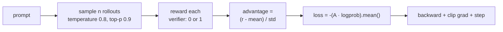

# Chapter 6 · GRPO — training with verifiable rewards

!!! abstract "In one line"

    Sample several answers, reward each with the verifier, and push probability
    toward the ones that beat their siblings. No reward model, no value network.

## Learning objectives

- Explain why GRPO needs no value network and what "group relative" means.
- Implement the five stages of a GRPO step.
- Run a real training loop and read its CSV output.
- Recognise the two failure modes — length blow-up and zero-variance groups.

## Why GRPO rather than PPO

Standard PPO needs a **critic**: a second network estimating the value of each
state, so it can compute advantages. For a language model, "state" is a partial
sequence — a critic is another model-sized network, and it is hard to train.

GRPO's trick is to use the **group** as the baseline. Sample `n` answers to the
same prompt, and compare each reward to the group mean. The group mean is a
free, unbiased-enough baseline, and the critic disappears.



## The reward

```python title="reasoning_from_scratch/ch06.py"
def reward_rlvr(answer_text, ground_truth):
    extracted = extract_final_candidate(
        answer_text, fallback=None  # Require \boxed{}
    )
    if not extracted:
        return 0.0
    correct = grade_answer(extracted, ground_truth)
    return float(correct)
```

Binary. No partial credit for a nearly-right answer, no credit for style. This is
deliberate: a shaped reward invites the model to optimise the shaping instead of
the answer.

What the reward rejects, with real values:

| Model output (ground truth `83`) | Reward | Why |
| --- | ---: | --- |
| `\\boxed{83}` | 1.0 | Correct and correctly formatted |
| `The correct answer is \\boxed{83}` | 1.0 | Extra prose is fine |
| `The final answer is 83` | **0.0** | No box — no reward, even though it is right |
| `We get \\boxed{38}` | 0.0 | Right format, wrong value |

That third row is the whole reason the model learns to format. Before any
training it answers correctly but unboxed and earns nothing.

## The five stages

```python title="reasoning_from_scratch/ch06.py · compute_grpo_loss"
def compute_grpo_loss(model, tokenizer, example, device,
                      num_rollouts=2, max_new_tokens=256,
                      temperature=0.8, top_p=0.9):
    assert num_rollouts >= 2
    roll_logps, roll_rewards, samples = [], [], []
    prompt = render_prompt(example["problem"])

    was_training = model.training
    model.eval()                                  # generation must not accumulate grads

    for _ in range(num_rollouts):
        # Stage 1: generate a rollout
        token_ids, prompt_len, text = sample_response(...)
        # Stage 2: reward it
        reward = reward_rlvr(text, example["answer"])
        # Stage 4: log-probability of what was generated
        logp = sequence_logprob(model, token_ids, prompt_len)
        roll_logps.append(logp); roll_rewards.append(reward)
        samples.append({"text": text, "reward": reward,
                        "gen_len": token_ids.numel() - prompt_len})

    if was_training:
        model.train()

    rewards = torch.tensor(roll_rewards, device=device)

    # Stage 3: normalise within the group -> advantages
    advantages = (rewards - rewards.mean()) / (rewards.std() + 1e-4)

    logps = torch.stack(roll_logps)
    pg_loss = -(advantages.detach() * logps).mean()
    loss = pg_loss        # chapter 7 adds a KL term here

    return {"loss": loss.item(), "pg_loss": pg_loss.item(),
            "rewards": roll_rewards,
            "advantages": advantages.detach().cpu().tolist(),
            "samples": samples, "loss_tensor": loss}
```

### The one line to understand

```python
advantages = (rewards - rewards.mean()) / (rewards.std() + 1e-4)
```

This is standardisation, and it has three consequences worth stating explicitly:

- **Absolute reward does not matter, only relative.** If all `n` rollouts fail,
  every advantage is 0 and there is no gradient. If all succeed, likewise. You
  learn only from *mixed* groups.
- **`+1e-4` prevents division by zero** when all rewards are identical.
- **`advantages.detach()` in the loss** is essential: the advantage is a constant
  weight on the log-probability, not something you backpropagate through. If you
  forget it, PyTorch will try to differentiate the reward computation and you
  will get nonsense or an error.

### Scoring only the generated tokens

```python title="reasoning_from_scratch/ch06.py"
def sequence_logprob(model, token_ids, prompt_len):
    logits = model(token_ids.unsqueeze(0)).squeeze(0).float()
    logprobs = torch.log_softmax(logits, dim=-1)
    selected = logprobs[:-1].gather(
        1, token_ids[1:].unsqueeze(-1)
    ).squeeze(-1)
    return torch.sum(selected[prompt_len - 1:])
```

Two offsets that are easy to get wrong. `logits[:-1]` pairs each position with
the token *after* it (next-token prediction). `[prompt_len - 1:]` drops the
prompt, so you reward only the tokens the model chose. Get that slice wrong and
you are training the model to reproduce the question.

## The training loop

```python title="reasoning_from_scratch/ch06.py · train_rlvr_grpo (abridged)"
def train_rlvr_grpo(model, tokenizer, math_data, device, steps=None,
                    num_rollouts=2, max_new_tokens=256, temperature=0.8,
                    top_p=0.9, lr=1e-5, checkpoint_every=50,
                    checkpoint_dir=".", csv_log_path=None):
    if steps is None:
        steps = len(math_data)
    optimizer = torch.optim.AdamW(model.parameters(), lr=lr)
    model.train()

    for step in range(steps):
        optimizer.zero_grad()
        example = math_data[step % len(math_data)]

        stats = compute_grpo_loss(model, tokenizer, example, device,
                                  num_rollouts, max_new_tokens,
                                  temperature, top_p)

        stats["loss_tensor"].backward()
        torch.nn.utils.clip_grad_norm_(model.parameters(), 1.0)
        optimizer.step()

        # log: loss, mean reward, mean response length
        append_csv_metrics(csv_log_path, step + 1, steps, stats["loss"],
                           reward_avg, avg_response_len)
```

Default hyperparameters, which are the book's:

| Parameter | Default | Note |
| --- | --- | --- |
| `num_rollouts` | 2 | Minimum for a group; the book uses more for real runs |
| `max_new_tokens` | 256 | Small by design for fast steps |
| `temperature` / `top_p` | 0.8 / 0.9 | Diversity for the group |
| `lr` | 1e-5 | AdamW |
| `grad clip` | 1.0 | Hard-coded in the loop |
| steps | `len(math_data)` = 12,000 | The book's analysed run is 500 steps |

## Run it

```python title="wk6_grpo.py"
from reasoning_from_scratch.ch02 import get_device
from reasoning_from_scratch.ch03 import load_model_and_tokenizer
from reasoning_from_scratch.ch06 import (
    load_math_train, compute_grpo_loss, train_rlvr_grpo,
)

device = get_device()
model, tokenizer = load_model_and_tokenizer(
    which_model="base", device=device, use_compile=False
)

math_train = load_math_train()      # 12,000 problems: MATH minus MATH-500
print(f"{len(math_train)} training problems")

# One step in isolation, to see rewards and advantages before committing
stats = compute_grpo_loss(model, tokenizer, math_train[0], device,
                          num_rollouts=2, max_new_tokens=256,
                          temperature=0.8, top_p=0.9)
print(stats["rewards"], stats["advantages"], stats["loss"])

# Then a real (short) run
model = train_rlvr_grpo(
    model, tokenizer, math_train, device,
    steps=50, num_rollouts=2, max_new_tokens=256, lr=1e-5,
    checkpoint_every=25, checkpoint_dir="checkpoints",
    csv_log_path="grpo_metrics.csv",
)
```

The training set fields: `problem`, `level`, `type`, `solution`, `answer`,
`unique_id`. Only `problem` and `answer` are used by the loop.

## What actually happens

From the repo's 500-step log of the original (no-KL) GRPO run:

| Step | Mean reward | Mean response length | MATH-500 |
| ---: | ---: | ---: | ---: |
| 1 | 0.000 | 6.4 tokens | 15.6% |
| 2 | 0.125 | 6.6 tokens | — |
| 499 | 1.000 | 237 tokens | — |
| 500 | 0.125 | 762 tokens | 33.0% |

Peak accuracy is **46.2% at step 50**. It then decays to 33.0% by step 500 while
mean response length grows by two orders of magnitude.

This is the single most instructive fact in the whole course, so state it
carefully. Mean reward is noisy — with two rollouts per step it can only be 0,
0.125, 0.5 or 1.0 — so a single step tells you nothing. What is unmistakable is the
trend: outputs get two orders of magnitude longer while accuracy decays.

And the direction is worth being precise about, because it is easy to guess wrong.
In this log, `reward_avg` and `avg_response_len` are **negatively** correlated
(r ≈ -0.74): the long late-stage outputs are mostly wrong. So this is not the model
successfully farming reward with padding — it is **degeneration**, a policy drift
into verbose, useless traces that satisfy neither the verifier nor the format. The
fixes in chapter 7 (clipped ratios) recover 8.6 points at step 500.

!!! danger "Two failure modes to watch from step one"

    **Length blow-up.** `avg_response_len` is a first-class metric, not a
    diagnostic. If it climbs, the policy is drifting — regardless of what reward
    does, and reward may well fall as it climbs. Fixes are in
    [chapter 7](ch07-reading-runs.md): clip the ratio, cap tokens, add a format
    reward.

    **Zero-variance groups.** With `num_rollouts=2` a group is either 0/0, 0/1, or
    1/1. Two of those three cases give zero advantage and no gradient. That is why
    real runs use more rollouts — a group of 8 with 3 successes carries far more
    signal than a group of 2.

## Compute reality check

The logs show roughly **47 tokens/second** on the author's GPU. A single step with
2 rollouts at up to 256 tokens is up to ~512 generated tokens plus a forward pass
for log-probabilities. Multiply out for your run and compare against your budget
before starting 500 steps.

## Exercises

1. **Find a zero-advantage group.** Print `rewards` and `advantages` for 20 steps.
   How many groups had all-identical rewards? What fraction of your compute
   produced no learning?
2. **Change `num_rollouts` to 4** and re-run 20 steps. Does reward climb faster?
   What does it cost in wall-clock?
3. **Predict the shortcut.** Before running 200 steps, write down what you expect
   `avg_response_len` to do. Then check.
4. **Break the reward.** Set `fallback="number_then_full"` in `reward_rlvr` and
   run 50 steps. Does accuracy improve or does formatting collapse?

## Checkpoint

- You have run `compute_grpo_loss` once and can explain every tensor's shape.
- Your CSV shows `reward_avg` above the ~0.125-0.25 noise floor.
- You can explain why `advantages.detach()` is not optional.
- You can state, without notes, why the run decays after step 50.

**Notebook:** [`05_grpo_training.ipynb`](../notebooks/05_grpo_training.ipynb) ·
**Source:** `reasoning_from_scratch/ch06.py` ·
**Video:** 6 of the course.
