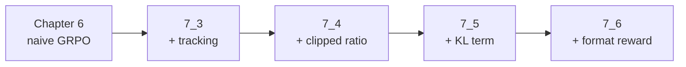

# Chapter 7 · Reading a training run

!!! abstract "In one line"

    Add four fixes to GRPO one at a time, compare the logs, and learn to diagnose a
    collapsed run from its metrics alone.

## Learning objectives

- Read the six metrics that describe a GRPO run and say what each should do.
- Explain clipped policy ratios, the KL term, and a format reward.
- Diagnose the repo's collapsed KL run from its CSV, without retraining.
- Decide which of the four fixes you would apply to a failing run, in what order.

## Why this chapter matters more than it looks

Chapter 6 gives you a loop that works for 50 steps and then degrades. Note what
"degrades" means here: in the shipped log the response length explodes and accuracy
falls, and reward is *negatively* correlated with length. The policy drifts rather
than exploits. Chapter 7 is
the difference between someone who can run a training script and someone who can
debug one. It is also the cheapest chapter to do well: the logs ship with the
repo, so the analysis runs on a laptop in minutes.

## The four variants



| Variant | Folder | Change | Result at step 500 |
| --- | --- | --- | ---: |
| 7_3 tracking | `03_rlvr_grpo_scripts_advanced/7_3_plus_tracking.py` | Extra metrics only | 33.0% (identical to ch6) |
| 7_4 clip ratio | `7_4_plus_clip_ratio.py` | PPO-style importance clipping | **41.6%** |
| 7_5 KL | `7_5_plus_kl.py` | Penalty on drift from reference | **0.0%** |
| 7_6 format reward | `7_6_plus_format_reward.py` | Reward for `<think>` tags | 35.0% |

7_3 producing *identical* numbers to chapter 6 is a feature: it proves the extra
instrumentation did not change the computation. When you add logging, that is the
test you want to pass.

## The metrics, and what each should do

| Column | What it is | Healthy behaviour | Alarm |
| --- | --- | --- | --- |
| `reward_avg` | Mean verifier reward in the group | Rises, plateaus | Stuck at 0 = no signal; pinned at 1 = too easy |
| `loss` | Policy-gradient loss | Noisy, near zero on average | Large negative drift = advantage × logprob exploding |
| `policy_ratio` | New vs old policy probability | Hovers near 1.0 | 3×, 10× = the policy moved too far in one step |
| `kl_loss` | Divergence from reference policy | Small and stable | Rising steadily = the model is drifting away |
| `entropy_avg` | Token-level entropy | Slow decline | Collapse to 0 = no exploration; **rise to double digits = degeneration** |
| `adv_std` | Spread of advantages | Non-zero | 0 = every rollout identical, no learning |
| `avg_response_len` | Tokens generated | Gradual growth | Runaway growth = policy drift |
| `eval_acc` | MATH-500 accuracy | Rises then plateaus | Falls while reward stays flat = degeneration |

## The clipped ratio

PPO's clipping, in one idea: if a single update changes the policy so much that
the new/old probability ratio leaves `[1-ε, 1+ε]`, clip the objective so the
gradient stops pushing further. It bounds how fast the policy can move per step.

Why it matters here: GRPO's advantage is normalised within a small group, so a
lucky group can produce a very large gradient. Clipping is the seatbelt.

The measured effect is exactly what you would want — the run stops decaying:

| Step | ch6 original | 7_4 clipped ratio |
| ---: | ---: | ---: |
| 1 | 15.6% | 15.6% |
| 50 | 46.2% | 45.2% |
| 100 | 43.4% | 45.6% |
| 250 | 41.2% | 41.6% |
| 500 | **33.0%** | **41.6%** |

The clipped run gives up a fraction of a point at the peak and keeps 8.6 points at
the end. That is the trade.

## The KL term, and the collapse

A KL penalty keeps the trained policy close to a frozen reference copy of the
starting model. In principle that is exactly what you want — it prevents the
degeneration you just saw.

In the repo's run, it destroyed the model:

| Step | `eval_acc` | `entropy_avg` | `kl_loss` |
| ---: | ---: | ---: | ---: |
| 1 | 15.6% | 1.27 | -0.10 |
| 50 | 40.8% | — | — |
| 100 | **0.0%** | — | — |
| 500 | 0.0% | **11.93** | 26.99 |

Read that last row carefully. `kl_loss` equals the total loss (26.99 in both
columns), meaning the KL term has completely taken over the objective.
`entropy_avg` at 11.93 is not "high entropy" in the healthy sense — for a
151,936-token vocabulary, uniform entropy is $$\\ln(151936) \\approx 11.93$$.
**The model is outputting a uniform distribution over the entire vocabulary.**
It has learned nothing except how to satisfy the KL term, and it produces
gibberish.

!!! warning "The lesson, stated precisely"

    A KL penalty without a tuned coefficient is not a safety net; it is a second
    objective that can dominate the first. The chapter's value is that it ships the
    failure rather than hiding it. If you add a KL term and your entropy climbs
    toward $$\\ln(V)$$, stop the run — you are watching a model being trained to
    be maximally uncertain.

    The diagnostic is trivial once you know it: **compare `kl_loss` to `loss`.** If
    they are the same number, the policy gradient has been switched off.

## The format reward

7_6 adds explicit reward for emitting `<think>` tags, on top of the verifier. Its
log starts at 50.8% accuracy at step 1 rather than 15.6%, so its starting point
differs from the other three — **do not compare its curve directly**. What you can
compare is the shape: it peaks at 56.2% at step 50 and decays to 35.0% by 500,
the same arc as chapter 6. A format reward shapes *how* the model answers; it does
not fix the length blow-up on its own.

## Do the analysis

The whole chapter as one script. No GPU, no model, just the shipped CSVs:

```python title="wk7_read_the_logs.py"
import pandas as pd

files = {
    "ch6 original (no KL)": "ch07/02_logs/ch06_rlvr_grpo_original_no_kl_metrics.csv",
    "+ clipped ratio":      "ch07/02_logs/7_4_plus_clip_ratio_metrics.csv",
    "+ KL term":            "ch07/02_logs/7_5_plus_kl_metrics.csv",
    "+ format reward":      "ch07/02_logs/7_6_plus_format_reward_metrics.csv",
}

for label, path in files.items():
    df = pd.read_csv(path)
    ev = df.dropna(subset=["eval_acc"])[["step", "eval_acc"]]
    print(f"\n{label}  ({len(df)} steps)")
    print(ev.to_string(index=False))

# the collapse, side by side
df = pd.read_csv(files["+ KL term"])
print(df[["step", "loss", "kl_loss", "entropy_avg", "eval_acc"]].tail(4))
```

The repo also provides `plot_grpo_metrics(csv_path, columns, save_as=None)` in
`reasoning_from_scratch/ch07.py` for the charts used in the book, plus
`moving_average` and `compute_advantage_stats`.

## Checkpoints you can load instead of training

Every variant's checkpoints are on Hugging Face as plain PyTorch `state_dict`s:

```python title="download a checkpoint"
from reasoning_from_scratch.qwen3 import download_qwen3_grpo_checkpoints

path = download_qwen3_grpo_checkpoints(
    grpo_type="clip_ratio",   # no_kl | tracking | clip_ratio | kl | format_reward
    step="00050",
    out_dir="qwen3",
)
```

Available folders: `7_3_plus_tracking`, `7_4_plus_clip_ratio`, `7_5_plus_kl`,
`7_6_plus_format_reward`. This is how you check your evaluation pipeline against
the book's numbers without paying for the training.

## Exercises

1. **Prove the collapse.** Load `7_5_plus_kl_metrics.csv` and show that
   `loss == kl_loss` from some step onward. At which step does it start?
2. **Quantify the drift — and be surprised.** Compute the correlation between
   `avg_response_len` and `reward_avg` for the chapter 6 run. It is **negative**
   (about -0.74), which is the opposite of the intuitive "longer answers farm more
   reward" story. Explain why: the late-stage long outputs are mostly wrong, so
   this is degeneration rather than a successful exploit. At which step does length
   start growing without a matching reward gain?
3. **Write the run report.** Given only these four CSVs and no context, write
   three sentences a colleague could act on.
4. **Propose a fifth fix.** What would you add to stop the decay that clipping
   only partly fixed? (Hint: think about what the reward is blind to.)

## Checkpoint

- You can name all six GRPO metrics and their healthy direction.
- You can explain, without the numbers, why the KL run collapsed.
- You know how to load a checkpoint and verify your evaluation against the book.

**Notebook:** [`06_reading_training_logs.ipynb`](../notebooks/06_reading_training_logs.ipynb) ·
**Source:** `reasoning_from_scratch/ch07.py`, `ch07/02_logs/*.csv` ·
**Video:** 7 of the course.
