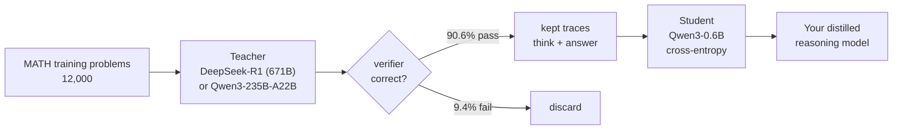

# Chapter 8 · Distillation

!!! abstract "In one line"

    If RL is too expensive, train the small model on a big model's reasoning
    traces with plain cross-entropy — after verifying every trace.

## Learning objectives

- Explain soft vs hard distillation and on-policy vs off-policy, and why practice
  chooses hard off-policy.
- Load, inspect and verify distillation data.
- Format `<think>`-tagged traces and build training examples.
- Train a student and read its loss curves.

## The idea

RL makes the model discover good reasoning. Distillation makes it *copy* good
reasoning that somebody else discovered. You need a teacher that already reasons
well, a set of problems, and a verifier to filter the teacher's mistakes.



The filter is the whole game. Without it you are training your student to
reproduce confident wrong answers — and unlike RL, supervised training has no
mechanism to discover that they are wrong.

## Soft vs hard, on-policy vs off-policy

Four combinations, and only one is common in practice. This taxonomy comes from
the chapter's lecture and is worth knowing because it is how papers describe
themselves.

**Soft distillation** trains on the teacher's full probability distribution over
the vocabulary at each position. **Hard distillation** trains on the sampled
tokens only.

Soft carries more information — a distribution says "answer 3 is likely, 5 is
plausible, 7 is impossible", where a sampled token says only "3". So why does
almost everyone use hard?

| Obstacle | Why it kills soft distillation |
| --- | --- |
| Vocabulary mismatch | DeepSeek-R1's tokenizer differs from Qwen3's; token 1100 in one is a different string in the other |
| API access | Hosted models do not return full logit distributions — some return top-100, which is not enough |
| Implementation | The composite loss (output loss + distribution loss) is more machinery for a marginal gain |

**On-policy** means generating data from the model you are currently training;
**off-policy** means collecting it beforehand. On-policy soft distillation is
effectively unused, because you would need the teacher's distribution over the
*student's* samples — which requires serving both models at once, with a shared
vocabulary.

The repo does **hard off-policy** distillation: collect teacher outputs once,
store them, train on them. That is what the shipped dataset is.

!!! note "When soft distillation does make sense"

    Within one model family. If you have Qwen3-235B and want a smaller Qwen3, you
    share a tokenizer, you have the weights, and you can generate logits. That is
    why the repo ships a `qwen3-235b-a22b-math-train` partition alongside the
    DeepSeek one — same method, friendlier teacher.

## The data

Four partitions, **12,000 entries each**, on Hugging Face under
`rasbt/math_distill`:

| Partition | Teacher | Use |
| --- | --- | --- |
| `deepseek-r1-math-train` | DeepSeek R1 (671B) | Train the student — the main one |
| `deepseek-r1-math500` | DeepSeek R1 | Held-out comparison |
| `qwen3-235b-a22b-math-train` | Qwen3 235B A22B | Same-family teacher |
| `qwen3-235b-a22b-math500` | Qwen3 235B A22B | Held-out comparison |

Each entry has exactly four fields:

| Field | Content |
| --- | --- |
| `problem` | The question |
| `gtruth_answer` | Verified ground truth |
| `message_thinking` | The teacher's reasoning trace |
| `message_content` | The teacher's final answer |

### Verify before you train

Run the chapter 3 verifier over the teacher's answers:

```bash
uv run evaluate_json.py \
    --json_path "deepseek-r1-math-train.json" \
    --gtruth_answer gtruth_answer \
    --generated_text message_content
```

Result: **90.6% (10,871 / 12,000)** pass. The 1,129 that fail are the reason this
step exists. It takes a few minutes and it is the difference between distillation
and noise injection.

## Formatting the traces

The student must learn the `<think>`-then-answer convention, so the training
target reproduces it exactly:

```python title="reasoning_from_scratch/ch08.py"
def format_distilled_answer(entry):
    content = str(entry["message_content"]).strip()
    if not content:
        raise ValueError("Missing non-empty 'message_content' field.")
    thinking = str(entry["message_thinking"]).strip()
    return f"<think>{thinking}</think>\n\n{content}"
```

Then build token sequences: prompt + answer + EOS, recording where the prompt
ends so the loss can ignore it.

```python title="reasoning_from_scratch/ch08.py · build_examples (abridged)"
for entry in data:
    prompt = render_prompt(entry["problem"])
    prompt_ids = tokenizer.encode(prompt)

    target_answer = format_distilled_answer(entry)
    answer_ids = tokenizer.encode(target_answer, chat_wrapped=False)

    token_ids = prompt_ids + answer_ids + [tokenizer.eos_token_id]
    examples.append({"token_ids": token_ids, "prompt_len": len(prompt_ids)})
```

`chat_wrapped=False` matters: the answer is *raw text* appended to an already
chat-wrapped prompt. Wrapping it again would nest template tokens inside the
target and teach the model to emit `<|im_start|>` mid-answer.

!!! danger "The tokenizer you must use"

    The student's **weights** are the base model. The **tokenizer** is the
    *reasoning* one — it knows the chat template and the thinking flag:

    ```python
    model, _ = load_model_and_tokenizer(which_model="base", ...)   # weights
    tokenizer = load_reasoning_tokenizer()                          # tokenizer
    ```

    Mixing these up is the most common failure in this chapter. Symptoms: garbage
    tokens, or a loss that never falls.

## Length filtering

Reasoning traces are long. The book filters at 2,048 tokens:

```python title="reasoning_from_scratch/ch08.py"
def filter_examples_by_max_len(examples, max_len=2048):
    filtered_examples = [s for s in examples if len(s["token_ids"]) <= max_len]
    print("Original:", len(examples))
    print("Filtered:", len(filtered_examples))
    print("Removed:", len(examples) - len(filtered_examples))
    return filtered_examples
```

Truncating instead of dropping would teach the model to stop mid-thought. Dropping
is the right call, and the removed fraction is a useful statistic about your
teacher's verbosity.

## Training

The loss is ordinary next-token cross-entropy on the answer tokens — no rewards,
no rollouts, no policy gradient:

```python title="reasoning_from_scratch/ch08.py · compute_example_loss (abridged)"
def compute_example_loss(model, example, device):
    token_ids = example["token_ids"]
    prompt_len = example["prompt_len"]

    input_ids = torch.tensor(token_ids[:-1], dtype=torch.long, device=device).unsqueeze(0)
    target_ids = torch.tensor(token_ids[1:], dtype=torch.long, device=device)

    logits = model(input_ids).squeeze(0)
    # ... cross-entropy over positions >= prompt_len - 1 ...
```

And the loop, which is the standard supervised shape — AdamW, per-example steps,
periodic validation, per-epoch checkpoints:

```python title="run it"
import random
from reasoning_from_scratch.ch02 import get_device
from reasoning_from_scratch.ch03 import load_model_and_tokenizer
from reasoning_from_scratch.ch08 import (
    load_distill_data, load_reasoning_tokenizer, build_examples,
    filter_examples_by_max_len, train_distillation, evaluate_examples,
)

device = get_device()
model, _ = load_model_and_tokenizer(which_model="base", device=device, use_compile=False)
tokenizer = load_reasoning_tokenizer()

data = load_distill_data(partition="deepseek-r1-math-train")
examples, skipped = build_examples(data, tokenizer)
examples = filter_examples_by_max_len(examples, max_len=2048)

rng = random.Random(123)
rng.shuffle(examples)
val_examples, train_examples = examples[:25], examples[25:]
print(f"train={len(train_examples)}  val={len(val_examples)}  skipped={skipped}")

print(f"val loss before: {evaluate_examples(model, val_examples[:3], device):.3f}")

train_distillation(
    model, train_examples=train_examples[:500], val_examples=val_examples,
    device=device, epochs=1, lr=5e-6, grad_clip_norm=1.0,
    log_every=50, checkpoint_dir="checkpoints",
    csv_log_path="distill_metrics.csv",
)

print(f"val loss after:  {evaluate_examples(model, val_examples[:3], device):.3f}")
```

Hyperparameters from the book: `epochs=2` default (the analysed run uses 3),
`lr=5e-6`, `grad_clip_norm=1.0`, validation on the first 25 examples, per-epoch
checkpoints.

## What the curves look like

The shipped log for the DeepSeek-R1 run — 3 epochs, ~20,000 steps:

| Epoch | Step | Train loss | Val loss |
| ---: | ---: | ---: | ---: |
| 1 | 50 | 0.766 | 0.699 |
| 1 | 100 | 0.746 | 0.668 |
| 3 | 20,000 | 0.436 | 0.534 |
| 3 | 20,046 | 0.556 | 0.534 |

Train falls from 0.766 to ~0.44; validation from 0.699 to 0.534. The gap widening
at the end is normal — you are fitting 12,000 specific traces. If validation
flattens or turns upward while training keeps dropping, stop: you are memorising
the teacher's phrasing rather than learning to reason.

## Using the published checkpoints

```python title="compare without training"
from reasoning_from_scratch.qwen3 import download_qwen3_distill_checkpoints

path = download_qwen3_distill_checkpoints(
    distill_type="deepseek_r1",   # or "qwen3_235b_a22b"
    step="06682",
    out_dir="qwen3",
)
```

These are plain PyTorch `state_dict`s for the `reasoning_from_scratch` model
class — **not** Hugging Face Transformers checkpoints. Load them into
`Qwen3Model(QWEN_CONFIG_06_B)` and use the reasoning tokenizer.

## Exercises

1. **Measure the teacher's failure rate yourself.** Run `evaluate_json.py` on the
   train partition and confirm 90.6%. Then look at three failing entries: are they
   wrong, or badly formatted?
2. **Skip the filter.** Train 200 steps on unfiltered data and compare validation
   loss against filtered data. What does the difference tell you?
3. **Truncate instead of drop.** Change `filter_examples_by_max_len` to truncate
   and inspect a few training targets. What did you teach the model to do?
4. **Compare teachers.** Train briefly on `qwen3-235b-a22b-math-train` and compare
   trace lengths and validation loss against DeepSeek's.

## Checkpoint

- Validation loss falls and you can plot it.
- Your distilled model emits a `<think>` block before the answer.
- You can explain why hard off-policy distillation is the practical default.
- You have re-run `evaluate_math500.py` on your student — that number is your result.

**Notebook:** [`07_distillation.ipynb`](../notebooks/07_distillation.ipynb) ·
**Source:** `reasoning_from_scratch/ch08.py`, `ch08/02_generate_distillation_data/` ·
**Video:** 8 of the course.
