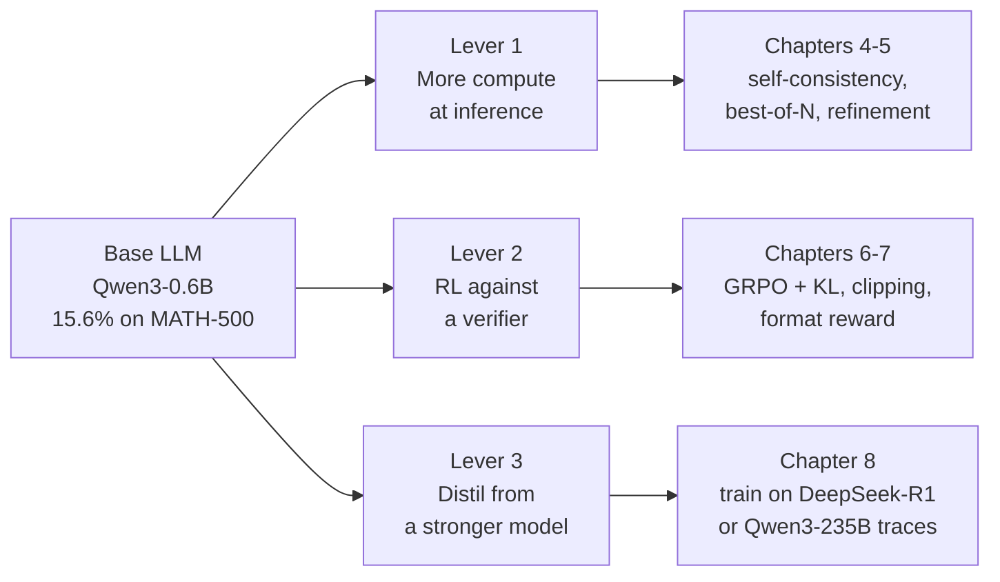

# Build a reasoning model from scratch

**A complete, hands-on tutorial for implementing reasoning models in PyTorch.**
You start with a small pre-trained Qwen3 model and build — yourself, line by
line — the evaluation harness, the inference-time scaling methods, the GRPO
training loop, and the distillation pipeline that turn it into a reasoning
model.

This guide follows Sebastian Raschka's free course *Building Reasoning Models
from the Ground Up* (8 videos, ~11 hours) and his book *Build a Reasoning
Model (From Scratch)*. It exists because the videos are a coding session, not
a syllabus: this is the syllabus, the transcript of what matters, the data
tables, the failure modes, and eight notebooks you can actually run.

## What you will have built at the end

| # | Artefact | Chapter |
| --- | --- | --- |
| 1 | A Qwen3-0.6B forward pass with streaming generation and a KV cache | [Ch 2](chapters/ch02-generation.md) |
| 2 | A math-answer verifier: `\boxed{}` extraction, LaTeX normalisation, SymPy equivalence | [Ch 3](chapters/ch03-verifier.md) |
| 3 | A reproducible MATH-500 baseline (~15.6%) | [Ch 3](chapters/ch03-verifier.md) |
| 4 | Inference-time scaling: temperature, top-p, self-consistency, best-of-N | [Ch 4](chapters/ch04-inference-scaling.md) |
| 5 | Self-refinement loops with heuristic and log-probability scorers | [Ch 5](chapters/ch05-self-refinement.md) |
| 6 | A GRPO training loop with verifiable rewards | [Ch 6](chapters/ch06-grpo.md) |
| 7 | The ability to read a training run and diagnose a collapse | [Ch 7](chapters/ch07-reading-runs.md) |
| 8 | A distilled 0.6B student trained on DeepSeek-R1's reasoning traces | [Ch 8](chapters/ch08-distillation.md) |

## The three levers

Everything in the course reduces to three mechanisms. If you can explain these
three, and implement one of them, you understand modern reasoning models.

The verifier you build in [chapter 3](chapters/ch03-verifier.md) is load-bearing
for all three: it is the evaluation metric, the RL reward function, and the
filter that decides which teacher answers are good enough to distil from.

## The numbers, before you start

This is the repository's own benchmark ladder on the full 500-question
MATH-500 test set. Read it before booking a GPU.

| Method | Model | MATH-500 | Runtime |
| --- | --- | ---: | ---: |
| Greedy decoding (baseline) | base | 15.6% | 10.1 min |
| Greedy decoding | reasoning | 48.2% | 182.1 min |
| Chain-of-thought prompt | base | 40.6% | 84.5 min |
| Temperature + top-p only | base | 17.8% | 30.7 min |
| Top-p + self-consistency (n=3) | base | 29.6% | 97.6 min |
| Self-consistency (n=10) + CoT | base | 52.0% | 862.6 min |
| Best-of-N (n=3), avg logprob | base | 43.2% | 330.2 min |
| Self-refinement, 1 iteration | base | 25.0% | 84.8 min |
| Self-refinement, 1 iteration | reasoning | 56.6% | 498.8 min |

Full table with all sixteen rows and the per-hardware runtime matrix:
[Results & benchmarks](reference/results.md).

!!! warning "Base and reasoning are two different checkpoints"

    The **base** model is raw pre-trained Qwen3-0.6B: it answers in one shot and
    scores 15.6%. The **reasoning** model is a version already post-trained to
    emit `<think>` traces; it scores 48.2% with no help at all. Every training
    run you do in chapters 6-8 starts from the **base** model.

    So your GRPO run is competing against a checkpoint somebody else spent
    serious compute on. Taking a base model from 15.6% into the low-to-mid 40s
    in 500 steps on one GPU is a genuinely good result. You are here to
    understand the reasoning checkpoint, not to beat it.

## How to use this guide

1. **[Orientation](start/orientation.md)** — what you are building and why it is
   structured this way. Ten minutes.
2. **[Setup](start/setup.md)** — hardware decision, install, smoke test. Thirty
   minutes.
3. **Chapters 2-8** — read the page, watch the video, run the notebook, then
   rewrite the notebook's code from scratch without looking.
4. **[Six-week plan](plan/six-week-plan.md)** — if you want a schedule with
   weekly gates instead of a pile of chapters.
5. **[Capstone](plan/capstone.md)** — point the pipeline at your own domain.

Each chapter page has the same anatomy, so you always know where you are:

| Section | What it gives you |
| --- | --- |
| Learning objectives | What you can do afterwards |
| Concepts | The explanation the video assumes |
| The code | Annotated, with the real signatures from the package |
| Worked example | Real output, verified against the repo |
| Exercises | Things to change and predict |
| Checkpoint | A test you can actually pass or fail |

## Prerequisites

You need comfortable Python and enough PyTorch to know what a tensor shape and
a backward pass are. You do **not** need the earlier *Build a Large Language
Model (From Scratch)* course — the author designed this as standalone — but if
attention and KV caching are fuzzy for you, that book is the gentler on-ramp.

Maths-wise, MATH-500 is competition-style high-school maths. You do not need to
solve the problems; you need to be able to read a `\boxed{}` answer and judge
whether two LaTeX expressions mean the same thing.
