# The six-week plan

The video course is 11 hours of watching. Doing the work is 40-60 hours. This
schedule assumes 7-9 hours a week and front-loads the cheap chapters so you reach
the expensive GPU work with a working harness.

```mermaid
gantt
    title Six weeks, eight chapters
    dateFormat X
    axisFormat %s
    section Local
    Ch2 Generation & KV cache      :0, 1
    Ch3 Verifier + baseline        :1, 2
    Ch4-5 Inference scaling        :2, 3
    section GPU
    Ch6 GRPO                       :3, 4
    Ch7 Reading runs               :4, 5
    Ch8 Distillation               :5, 6
    section Optional
    Capstone                       :6, 7
```

## Week 1 — Generation and KV caching

**Chapter 2 · Videos 1-2 · ~6 h · CPU is fine**

Watch video 1 for setup and hardware, video 2 for the mechanics. Then read
`reasoning_from_scratch/ch02.py` end to end — it is about 200 lines and there is
no reason to leave any of it unread.

**Build:** a benchmark that times 100-token generation with and without the KV
cache on your hardware. This is your first real measurement, and it tells you
what the rest of the course will cost.

**Gate:** you have a tokens/sec number you can quote, and the cached version wins
by several times.

→ [Chapter 2](../chapters/ch02-generation.md) · [Notebook](../notebooks/01_generation_and_kv_cache.ipynb)

## Week 2 — The verifier

**Chapter 3 · Video 3 · ~8 h · CPU fine for a 50-question subset**

The chapter that looks like string-munging and is actually the foundation. Build
your own test table for `grade_answer` before running anything large — the
exercise teaches you what a reward function really is: a specification, with bugs.

**Build:** the test table, then `evaluate_math500.py --dataset_size 50`.

**Gate:** test table passes; accuracy is in the 10-25% range on 50 questions.
At 500 the expected figure is 15.6% (78/500).

→ [Chapter 3](../chapters/ch03-verifier.md) · [Notebook](../notebooks/02_verifier_and_baseline.ipynb)

## Week 3 — Inference-time scaling

**Chapters 4-5 · Videos 4-5 · ~8 h · GPU strongly preferred**

Two chapters, one idea: buy accuracy with compute. Run the ladder on 50
questions, not 500 — you are looking for shape, not precision.

**Build:** self-consistency with vote inspection, and one refinement loop.

**Gate:** you can explain why n=10 is only worth ~2 points over n=3 without CoT,
and why self-refinement *hurts* the base model (25.0%) versus CoT (40.6%).

→ [Chapter 4](../chapters/ch04-inference-scaling.md) · [Chapter 5](../chapters/ch05-self-refinement.md) ·
[Notebooks](../notebooks/index.md)

## Week 4 — GRPO

**Chapter 6 · Video 6 · ~9 h · GPU required**

The chapter the course builds toward. Read `compute_grpo_loss` until you can
explain every line, then run 50 steps.

**Build:** one isolated `compute_grpo_loss` call, then a 50-step run with a CSV
log.

**Gate:** `reward_avg` rises above the ~0.125-0.25 noise floor. Reference point:
the book's run goes 15.6% → 46.2% in the first 50 steps.

!!! warning "The thing to watch"

    `avg_response_len`. In the book's 500-step run it goes from 6 tokens to 762,
    with steps hitting the 1024 cap, while accuracy peaks at step 50 and decays.
    Reward and length are *negatively* correlated (r ≈ -0.74) in that log, so this
    is degeneration rather than successful reward hacking — but the early warning
    is the same metric, and week 5 explains it.

→ [Chapter 6](../chapters/ch06-grpo.md) · [Notebook](../notebooks/05_grpo_training.ipynb)

## Week 5 — Reading a training run

**Chapter 7 · Video 7 · ~7 h · GPU for reruns, laptop for analysis**

The cheapest chapter to do well: the logs ship with the repo, so the analysis runs
on a laptop in minutes.

**Build:** the four-variant comparison, plus a written diagnosis of the KL collapse.

**Gate:** you can explain why `7_5_plus_kl` hit 0.0% — that `kl_loss` equals total
`loss`, and `entropy_avg` ≈ 11.93 ≈ ln(151,936), i.e. a uniform distribution over
the whole vocabulary. And you can say why the chapter 6 run decays: length grows,
accuracy falls, and the two are negatively correlated.

→ [Chapter 7](../chapters/ch07-reading-runs.md) · [Notebook](../notebooks/06_reading_training_logs.ipynb)

## Week 6 — Distillation

**Chapter 8 · Video 8 · ~8 h · GPU required**

Cheaper than RL: no rollouts, no policy gradient, just cross-entropy on verified
teacher traces.

**Build:** format the traces, filter by length, train briefly, evaluate.

**Gate:** validation loss falls; the model emits `<think>` before its answer; you
have run `evaluate_math500.py` on your student.

→ [Chapter 8](../chapters/ch08-distillation.md) · [Notebook](../notebooks/07_distillation.ipynb)

## Week 7 (optional) — Make it yours

**~5 h**

Wire the checkpoint into a Chainlit chat UI (appendix G, needs Python 3.13), then
point the pipeline at your own domain — SQL correctness, unit conversions, a
scheduling puzzle generator. The verifier is the only thing you have to rewrite.

→ [Capstone](capstone.md)

## If you fall behind

| Situation | Cut this |
| --- | --- |
| No GPU at all | Weeks 4-6 become "load the published checkpoints and evaluate them" |
| Two weeks, not six | Weeks 1-2 fully, then read chapters 6-7 without running |
| Halfway through week 4 and stuck | Skip to week 5's analysis — it is laptop-only and teaches the most per hour |

The chapters are independent enough to reorder, with one exception: **do not skip
chapter 3.** Every later chapter's number depends on it.
