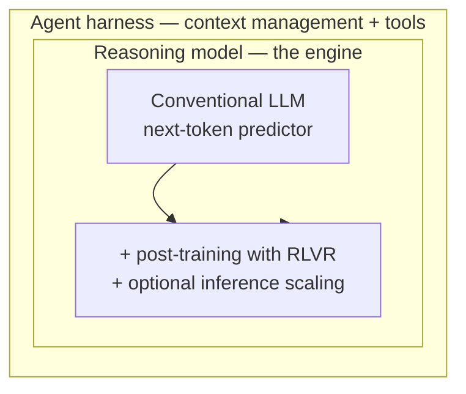
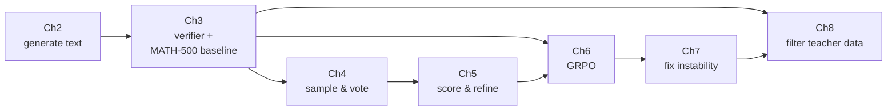

# Orientation: what you are building, and why in this order

## Learning objectives

By the end of this page you can:

- Explain how a conventional LLM, a reasoning model, and an agent harness relate.
- Name the three levers that produce reasoning, and say which chapter implements each.
- Predict roughly what a 0.6B model can and cannot do before you spend compute.
- Decide which parts of the course you can run on your own machine.

## Three things that get confused with each other

People use "reasoning model" to mean at least three different things. The course
is precise about it, and so should you be:

- A **conventional LLM** is a next-token predictor. Ask it a maths question and
  it emits an answer immediately, because the training objective rewarded
  plausible text, not correct derivations.
- A **reasoning model** is the same engine, upgraded: post-training with
  reinforcement learning against a *verifiable* reward, so it learns to spend
  tokens thinking before committing. Optionally you also scale inference
  compute — sample many candidates and pick.
- An **agent harness** is the software around the model: context management,
  tool calls, loops. The model is the engine; the harness is the rest of the
  vehicle.

Almost every current-generation LLM is either a reasoning model or has a
reasoning mode. That is why this is worth a week of your time: it is no longer
a specialist technique.

!!! note "Why RLVR and not RLHF"

    RLHF needs a *learned* reward model trained on human preferences — expensive,
    fuzzy, and easy to game. **RLVR** (reinforcement learning with verifiable
    rewards) needs a function that returns 0 or 1. For maths, that function is
    "does the boxed answer equal the ground truth", which you can write in an
    afternoon. This is the single reason a 0.6B reasoning model is trainable on
    one GPU, and why chapter 3 — the verifier — comes before any training.

## The three levers

| Lever | What it costs | What it buys | Where |
| --- | --- | --- | --- |
| More compute at inference | GPU minutes per question, forever | +10 to +35 points, no training | Chapters 4-5 |
| RL against a verifier | One training run, then cheap inference | The model learns to think; largest durable gain | Chapters 6-7 |
| Distillation from a stronger model | Data generation (or download) + one supervised run | Most of the RL benefit for a fraction of the compute | Chapter 8 |

The trade-offs are real and the course measures them. Inference scaling is
brutal at the top end: self-consistency with n=10 and a CoT prompt reaches 52.0%
but takes **862 minutes** on 500 questions — 86× the greedy baseline's 10
minutes, for 36 points. GRPO reaches a comparable place and then answers at
greedy speed.

## Why the order is 3, then 4-5, then 6, then 8

The sequence looks arbitrary until you see that each chapter's output is the
next chapter's input:

- You cannot evaluate without a verifier (ch 3).
- You cannot sample-and-vote without knowing your baseline (ch 4).
- You cannot score candidates without having generated several (ch 5).
- You cannot compute a reward without the verifier (ch 6).
- You cannot fix a collapsed run without metrics worth plotting (ch 7).
- You cannot filter teacher answers without the verifier again (ch 8).

Every arrow into chapter 3 is the same function.

## What a 0.6B model can actually do

The honest framing, which saves you from disappointment:

**It can learn format and effort.** Most of the 15.6% → 46% jump in the first 50
GRPO steps is the model learning to produce a step-by-step trace and end with
`\boxed{answer}`. That is a formatting lesson with a mathematical side effect,
and it is why the gain arrives so fast.

**It cannot learn mathematics it never saw.** MATH-500 is competition-level.
A 0.6B model plateaus in the 40s-to-50s. If you want higher, the lever is a
bigger model, not a better loop.

**It will degenerate if you let it.** In the repo's 500-step log, average response
length goes from **6 tokens to 762**, with steps hitting the 1024-token cap, while
accuracy peaks at 46.2% (step 50) and decays to 33.0% (step 500). The output gets
longer and worse: in that log reward and length are *negatively* correlated
(r ≈ -0.74). So this is drift into verbose rambling rather than a successful
exploit — but the diagnostic is the same, and `avg_response_len` is the early
warning. That is the whole of chapter 7 in one sentence.

## Decide your compute now

| You have | Do this | Skip |
| --- | --- | --- |
| Laptop, no GPU | Ch 2-3 on CPU, ch 4-5 on 50 questions, read ch 6-7 | Long evals, all training |
| Apple Silicon | Everything up to ch 5 locally | Ch 6-8 training |
| One rented GPU | The whole course | Nothing |
| Free Colab T4 | Ch 2-5, plus a 50-step GRPO taste | 500-step runs, distillation |

The [no-GPU path](setup.md#if-you-only-have-a-laptop) has the detail.

## Checkpoint

Before moving on, answer these without looking:

1. Why does a verifiable reward make RL cheaper than RLHF?
2. Which chapter's function is reused by every later chapter, and in what three roles?
3. Your GRPO run's reward climbs while MATH-500 accuracy falls. What are the two most likely causes?

If the third one is not obvious yet, that is fine — it is the point of
[chapter 7](../chapters/ch07-reading-runs.md). If the first two are not obvious, re-read
this page.
